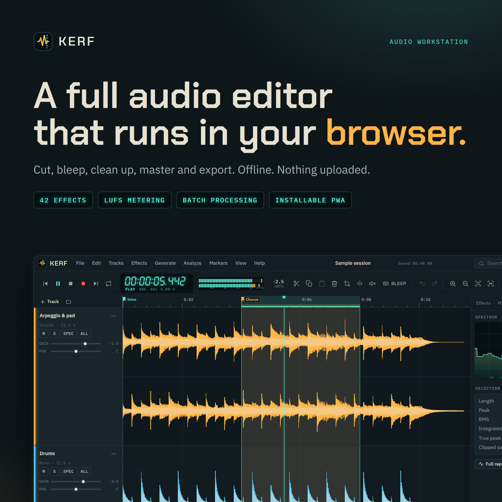
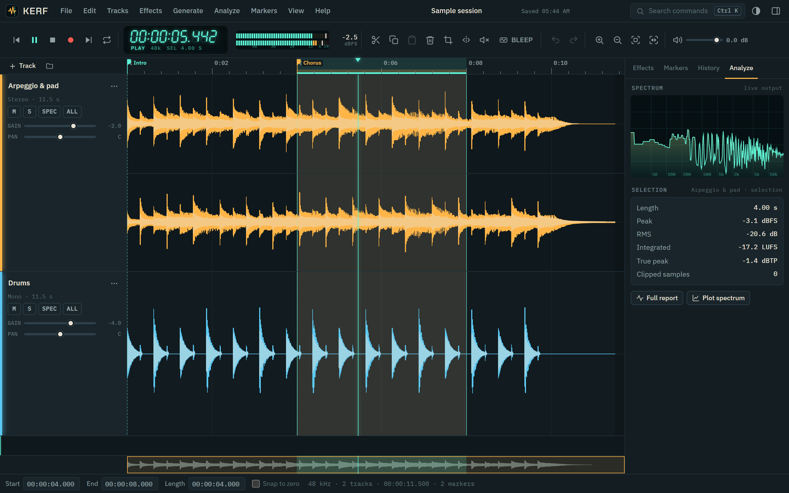
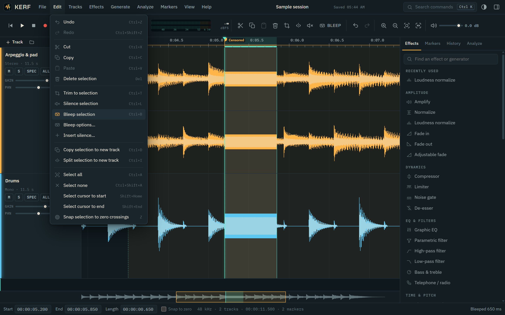
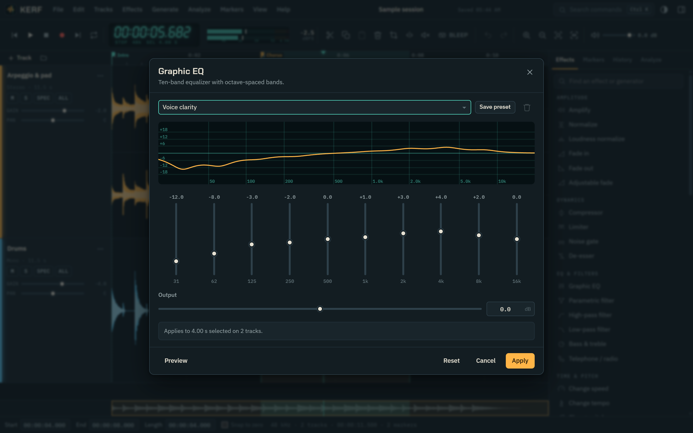
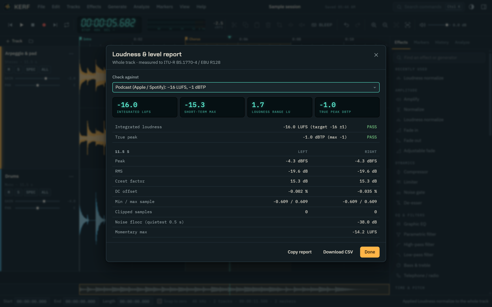
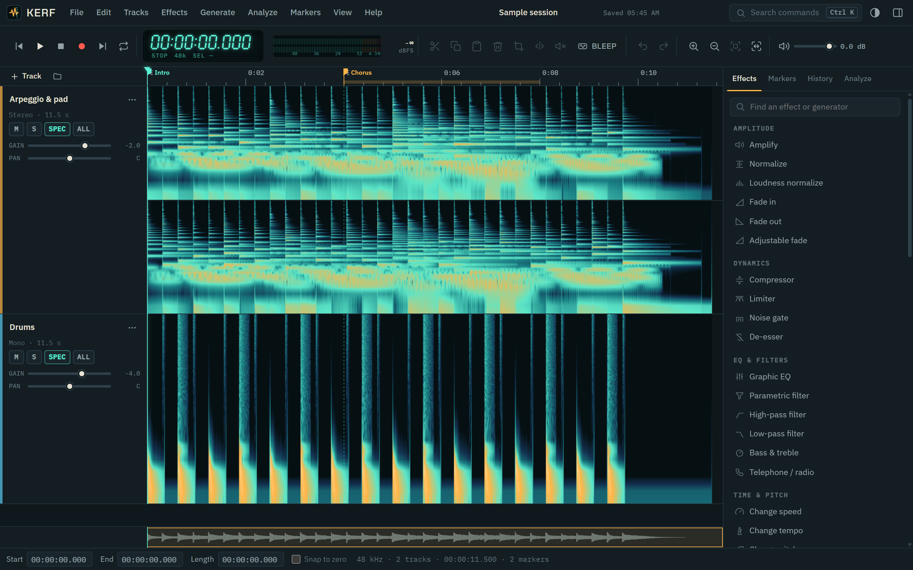
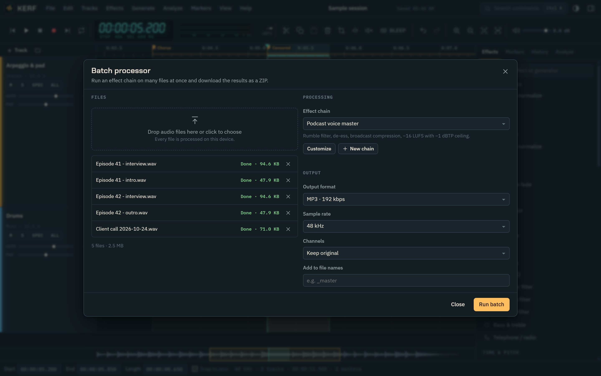
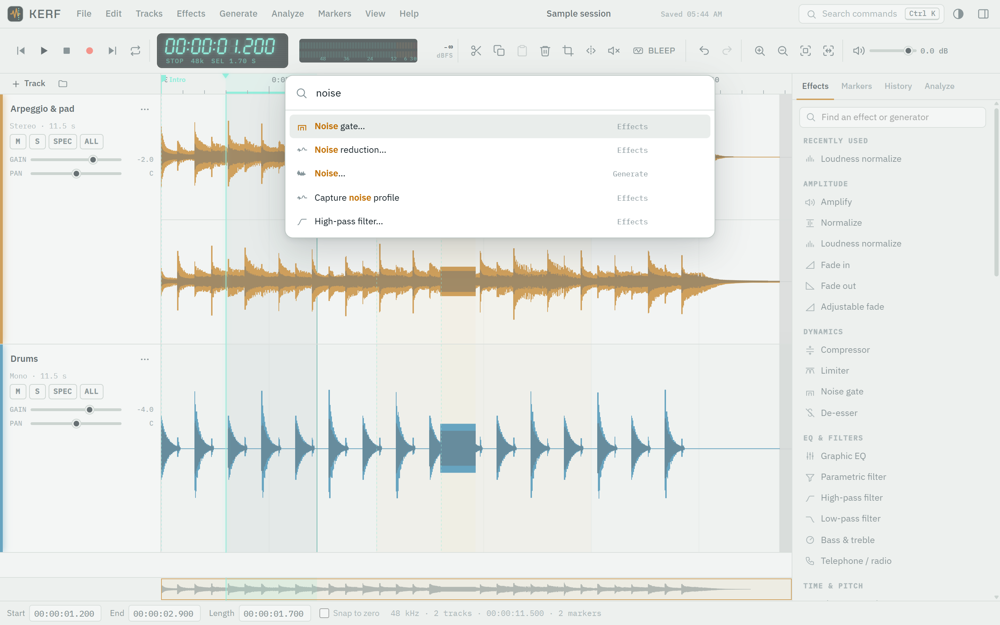
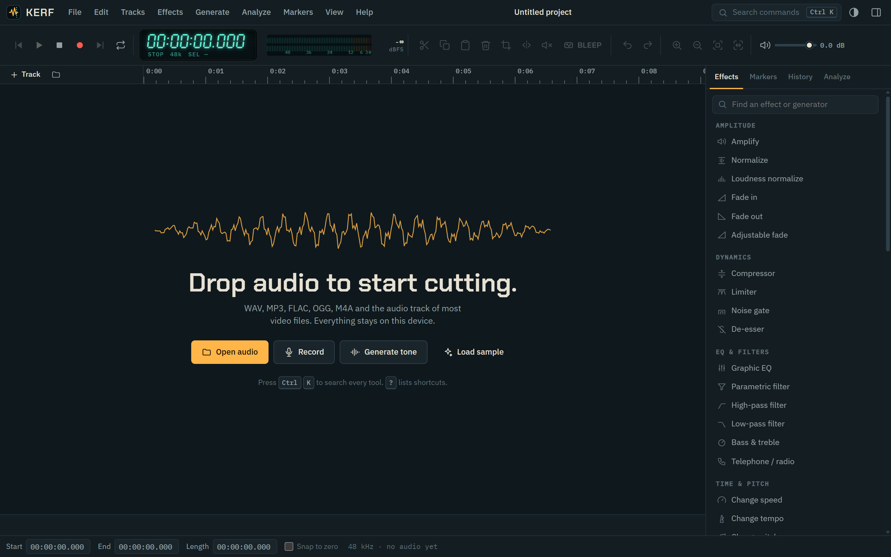
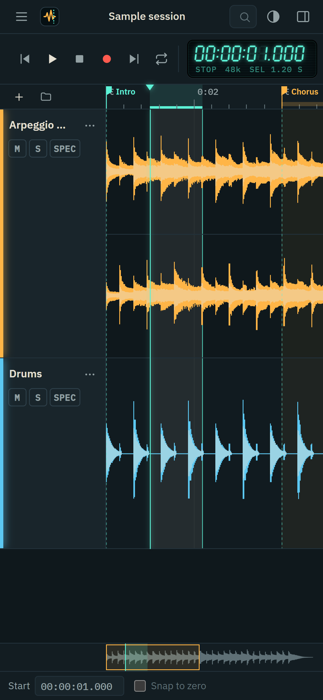

# Kerf — browser audio workstation



Kerf is a multitrack audio editor that runs entirely in the browser. It installs as a
Progressive Web App, works offline, and never uploads audio: decoding, editing, effects and
export all happen on the user's device.

It is a static site with no build step, so it can be hosted on GitHub Pages (or any static
host) as-is.

## Screenshots

**Multitrack editor** — waveforms, markers, live level meters and a running spectrum.



**Bleep to censor** — select a word and press `Ctrl+B`.



**Effects with live curves and presets** — the 10-band graphic EQ.



**Loudness report** — integrated LUFS, loudness range and true peak, with pass/fail checks
against podcast, streaming, broadcast and audiobook specs.



**Spectrogram view**



**Batch processor** — run an effect chain over many files and download a ZIP.



**Light theme and command palette** (`Ctrl+K`)



**Start screen and phone layout**

<p>
  
  
</p>

## Features

**Editing** — multitrack timeline with per-track gain, pan, mute and solo; cut, copy, paste,
delete, trim to selection, silence, insert silence, split or copy a selection to a new track,
snap to zero crossings, unlimited-style undo/redo with a clickable history list.

**Bleep / censor** — select a word and press `Ctrl+B` to replace it with a bleep tone (or
silence). Tone frequency and level are configurable under *Edit › Bleep options*.

**Effects (42)**
- Amplitude: amplify, normalize, loudness normalize (BS.1770 / EBU R128 presets), fade in,
  fade out, adjustable fade
- Dynamics: compressor, look-ahead limiter, noise gate, de-esser
- EQ & filters: 10-band graphic EQ, parametric filter, high-pass, low-pass, bass & treble,
  telephone / radio
- Time & pitch: change speed, change tempo (WSOLA, pitch preserved), change pitch (length
  preserved), reverse, repeat
- Delay & reverb: echo, reverb
- Modulation: chorus, flanger, phaser, vibrato, tremolo, auto-pan, ring modulator
- Distortion: distortion (5 characters), bitcrusher, invert polarity
- Restoration: spectral noise reduction with noise-profile capture, click removal, hum
  removal (50/60 Hz + harmonics), DC offset removal, truncate silence
- Stereo: stereo width, swap channels, vocal remover, mix to mono

Every effect has a live preview, built-in presets and user-saved presets.

**Generators** — tone, beep, chirp/sweep, white/pink/brown noise, DTMF, click track,
Morse code, silence.

**Recording** — microphone/line-in capture via AudioWorklet, punch-in at the cursor, overdub
with latency compensation, input device selection.

**Analysis** — loudness & level report (integrated LUFS, LRA, short-term/momentary max, true
peak, per-channel peak/RMS/DC/crest, noise floor) with pass/fail checks for podcast,
streaming, EBU R128, ATSC A/85 and ACX audiobook specs; CSV/clipboard export of reports;
spectrum plot with note readout; live output spectrum and stereo level meters; find clipping;
find silence; spectrogram track view.

**Markers** — point markers and labelled regions, drag to move, Audacity-compatible label
import/export (`.txt`) and CSV export. Markers are embedded as cue points in exported WAV files.

**Export** — WAV 16-bit (dithered), 24-bit, 32-bit float; MP3 64–320 kbps; mix, selection,
selected tracks, or every track as a separate file in a ZIP; resampling; mono/stereo; title,
artist, album, year and comment tags (RIFF INFO / ID3v2).

**Batch processing** — run an effect chain over many files and download a ZIP. Built-in
chains: podcast voice master, EBU R128 broadcast, voice cleanup, ACX audiobook, tighten
pauses. Chains can be created, customised and applied to a selection too.

**Projects** — the session autosaves to the browser (IndexedDB) and restores on reload.
Projects can be saved to and opened from portable `.kerf` files (ZIP of lossless 32-bit WAVs
plus JSON).

**App** — installable PWA, offline after first load, update prompt on new releases, opens
audio files from the OS when installed (file handlers), accepts files from the Android share
sheet, command palette (`Ctrl+K`), full keyboard control, dark and light themes, responsive
down to phone width.

## Deploy to GitHub Pages

1. Create a repository and push this folder to the `main` branch.
2. In the repository, open **Settings › Pages** and set **Source** to **GitHub Actions**.
3. The included workflow (`.github/workflows/deploy.yml`) publishes the site on every push
   to `main`. The app will be live at `https://<user>.github.io/<repo>/`.

All paths are relative, so the app works from a project subpath without configuration.
The workflow stamps the commit hash into `sw.js`, which makes installed copies offer an
update as soon as a new version is deployed.

If you prefer **Deploy from a branch** instead of Actions, that works too; the service worker
still refreshes cached files in the background, but installed apps won't show the explicit
"new version" prompt.

## Run locally

Any static file server works, for example:

```sh
python -m http.server 8000
# or
npx serve .
```

Then open <http://localhost:8000>. On `localhost` the service worker is skipped so code
changes show up on reload; add `?sw` to the URL to test offline mode locally. Microphone
recording requires `localhost` or HTTPS.

## Browser support

Current Chrome, Edge, Firefox and Safari (desktop and mobile). Which compressed formats can
be *imported* depends on the browser's decoders: WAV, MP3, OGG/Opus and AAC/M4A are widely
supported; FLAC is supported in Chrome, Edge, Firefox and Safari 14+. File handlers and the
share target are Chromium features (desktop install / Android).

## Keyboard shortcuts

Press `?` in the app for the full list. The essentials:

| Action | Keys |
| --- | --- |
| Play / pause | `Space` |
| Record | `R` |
| Cut / copy / paste | `Ctrl+X` / `Ctrl+C` / `Ctrl+V` |
| Delete selection | `Delete` |
| Trim to selection | `Ctrl+T` |
| Bleep selection | `Ctrl+B` |
| Undo / redo | `Ctrl+Z` / `Ctrl+Shift+Z` |
| Add marker / label selection | `M` / `Shift+M` |
| Zoom in / out / fit / to selection | `=` / `-` / `F` / `E` |
| Command palette | `Ctrl+K` |
| Export | `Ctrl+E` |

On macOS use `⌘` in place of `Ctrl`.

## Project structure

```
index.html              App shell
manifest.webmanifest    PWA manifest (icons, shortcuts, file handlers, share target)
sw.js                   Service worker (offline cache, update flow, share target)
css/app.css             All styles and theme tokens
icons/                  App icons (regenerate with: node tools/make-icons.mjs)
docs/screenshots/       Screenshots used in this README
js/main.js              Boot, keyboard routing, drag-and-drop, PWA wiring
js/app.js               Project state, edit operations, transport, persistence
js/commands.js          Command registry (menus, palette and shortcuts)
js/core/                AudioData model, history, settings, storage, formatting
js/audio/               Playback engine, offline mixdown, recorder
js/dsp/                 Effects, generators, filters, FFT, loudness, time-stretch
js/io/                  WAV, MP3, ZIP, project files, labels, decoding
js/ui/                  Timeline, dialogs, menus, side panel, export, batch
js/worklets/            AudioWorklet recorder
js/vendor/lame.min.js   MP3 encoder (lamejs, LGPL — see LAMEJS-LICENSE.txt)
```

## Privacy

Kerf has no backend, accounts, telemetry or analytics. Audio stays in the browser tab and in
the browser's local storage for autosave. Web fonts are loaded from Google Fonts on first
visit and then cached for offline use.

## Third-party components

- [lamejs](https://github.com/zhuker/lamejs) 1.2.1 — MP3 encoding, LGPL-3.0
- Chakra Petch and IBM Plex typefaces — SIL Open Font License
